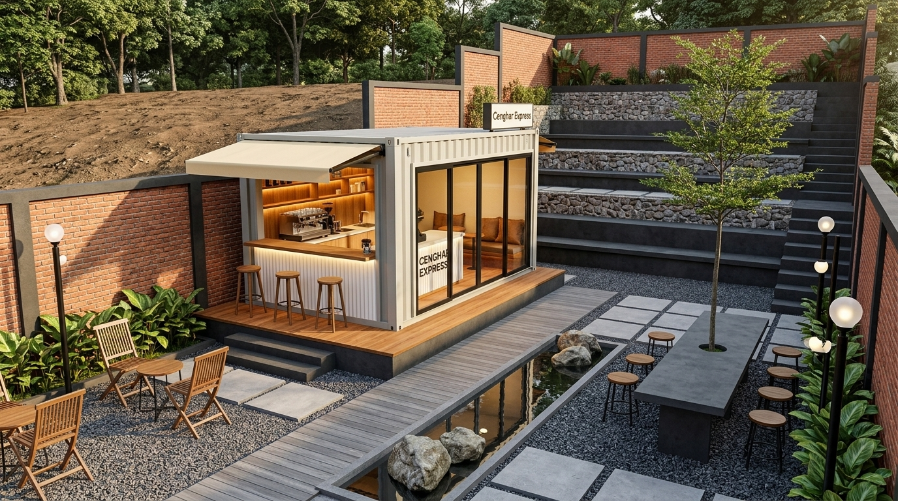

# CengharExpress-architect-designer

Repositori utama **Arsitektur, Tata Ruang (Layout), & Visualisasi 3D Kafe Cenghar Express** untuk 3 lokasi cabang:
1. **Cenghar Cililin** ([`projects/01-cenghar-cililin/`](./projects/01-cenghar-cililin/)) — ✅ *Design v1 Selesai (Blender 3D Renders + Studio 3D Interaktif 360°)*
2. **Cenghar Tangerang** ([`projects/02-cenghar-tangerang/`](./projects/02-cenghar-tangerang/)) — ⏳ *Menunggu Foto & Dimensi Lahan*
3. **Cenghar Kodim Cimahi** ([`projects/03-cenghar-kodim-cimahi/`](./projects/03-cenghar-kodim-cimahi/)) — 🔥 **[URGENT / PRIORITAS UTAMA SAAT INI]**

---

## ⚠️ Aturan Wajib untuk Semua AI Agent (`AGENTS.md` / `CLAUDE.md`)

> **Setiap AI Agent (Antigravity, Claude Code, Cursor, Codex, Hermes, OpenClaw) WAJIB meng-install dan memuat 7 Skill Arsitektur & 3D di bawah ini sebelum membuat atau memodifikasi desain kafe di repositori ini.**

### Daftar Skill Arsitektur & 3D yang Wajib Di-install

| No | Nama Skill | File Lokal di Repo | Link Sumber GitHub | Fungsi Utama |
| :-: | :--- | :--- | :--- | :--- |
| 1 | **`cafe-architect-designer`** | [`skills/cafe-architect-designer/SKILL.md`](./skills/cafe-architect-designer/SKILL.md) | [Jeffallan/claude-skills#77](https://github.com/Jeffallan/claude-skills/issues/77) | Arsitektur kafe, *Container Booth* 20ft/40ft, adaptasi lahan kontur/terasering, & studio 3D 360°. |
| 2 | **`archviz`** | [`skills/archviz/SKILL.md`](./skills/archviz/SKILL.md) | [arjun988/blender-skills](https://github.com/arjun988/blender-skills/tree/main/.claude/skills/archviz) | Visualisasi arsitektur skala nyata (meter/milimeter), koreksi perspektif kamera 2-titik, & standar *delivery* render. |
| 3 | **`environment-artist`** | [`skills/environment-artist/SKILL.md`](./skills/environment-artist/SKILL.md) | [arjun988/blender-skills](https://github.com/arjun988/blender-skills/tree/main/.claude/skills/environment-artist) | Modul bangunan, talud batu kali, dinding bata merah ekspos, *stepping stone*, & lanskap tropis (*Ketapang Kencana*, *Calathea Lutea*). |
| 4 | **`set-dressing`** | [`skills/set-dressing/SKILL.md`](./skills/set-dressing/SKILL.md) | [arjun988/blender-skills](https://github.com/arjun988/blender-skills/tree/main/.claude/skills/set-dressing) | Tata letak furnitur kafe, peralatan *espresso bar*, meja komunal beton, *bar stool*, & jarak sirkulasi pengunjung. |
| 5 | **`blender-lighting-lookdev`** | [`skills/blender-lighting-lookdev/SKILL.md`](./skills/blender-lighting-lookdev/SKILL.md) | [EL4CTEO/blender-skills](https://github.com/EL4CTEO/blender-skills/tree/main/skills/blender-lighting-lookdev) | Pencahayaan arsitektur *Daylight*, *Golden Hour*, & *Twilight/Night* (LED strip meja bar, lampu bola taman, *uplight* bata, lampu tangga). |
| 6 | **`blender-pbr-materials`** | [`skills/blender-pbr-materials/SKILL.md`](./skills/blender-pbr-materials/SKILL.md) | [EL4CTEO/blender-skills](https://github.com/EL4CTEO/blender-skills/tree/main/skills/blender-pbr-materials) | Material PBR realistis (besi gelombang container, bata merah ekspos, batu kali, beton acian, kayu jati, kaca `IOR 1.52`, air kolam `IOR 1.333`). |
| 7 | **`threejs-interaction`** | [`skills/threejs-interaction/SKILL.md`](./skills/threejs-interaction/SKILL.md) | [CloudAI-X/threejs-skills](https://github.com/CloudAI-X/threejs-skills/tree/main/skills/threejs-interaction) | Kontrol kamera 3D interaktif: Putar 360° (*Orbit*), Geser Lahan (*Pan*), *Zoom damping*, & pin *hotspot* 3D. |

### Cara Install Cepat (Untuk AI Agent & Developer)

```bash
# Otomatis menyalin ke .claude/skills, ~/.claude/skills, dan ~/.agents/skills
bash ./scripts/install-skills.sh
```

*(Untuk AI Agent yang memiliki tool `save_skill`, wajib panggil `save_skill` pada ke-7 folder di `./skills/<nama-skill>` jika belum terdaftar di `list_skills`).*

---

## Status 3 Project Layout Kafe Cenghar

### 1. [Cenghar Cililin](./projects/01-cenghar-cililin/) — ✅ Selesai (v1)
- **Kondisi Lahan**: Lahan berundak / terasering batu kali 3 tingkat + tangga kanan eksisting + area parkir bawah.
- **Konsep Desain**:
  - **Booth Utama**: *Container Cafe 20ft* putih-krem (`#EAE8E3`) di atas dek kayu jati + 2 trap tangga gelap, jendela bar terbuka dengan awning lipat krem + 4 *bar stool* kayu di sisi kiri, dan pintu kaca geser *frame* hitam + ruang duduk *indoor* di sisi kanan.
  - **Courtyard & Lanskap**: Dinding keliling bata merah ekspos, jalur dek kayu abu-abu dengan **kolam refleksi batu alam** di tengah, batu koral abu-abu + *stepping slab* beton `100×100 cm`, meja komunal beton panjang dengan pohon *Ketapang Kencana* menembus meja, tanaman *Calathea Lutea*, dan lampu taman tiang hitam bola putih.
- **Deliverables**:
  - [Studio 3D Interaktif 360° (`preview-360-3d.html`)](./projects/01-cenghar-cililin/preview-360-3d.html)
  - [Galeri Render 3D Blender & Spesifikasi (`projects/01-cenghar-cililin/README.md`)](./projects/01-cenghar-cililin/README.md)



---

### 2. [Cenghar Tangerang](./projects/02-cenghar-tangerang/) — ⏳ Queued
- Dokumentasi dan folder kerja tersedia di [`projects/02-cenghar-tangerang/`](./projects/02-cenghar-tangerang/).

---

### 3. [Cenghar Kodim Cimahi](./projects/03-cenghar-kodim-cimahi/) — 🔥 URGENT (Prioritas Utama)
- Dokumentasi dan folder kerja tersedia di [`projects/03-cenghar-kodim-cimahi/`](./projects/03-cenghar-kodim-cimahi/).
- Siap menerima foto lahan, ukuran dimensi, dan brief kebutuhan untuk langsung dibuatkan **Render 3D Blender** + **Studio 3D Interaktif 360°**.
