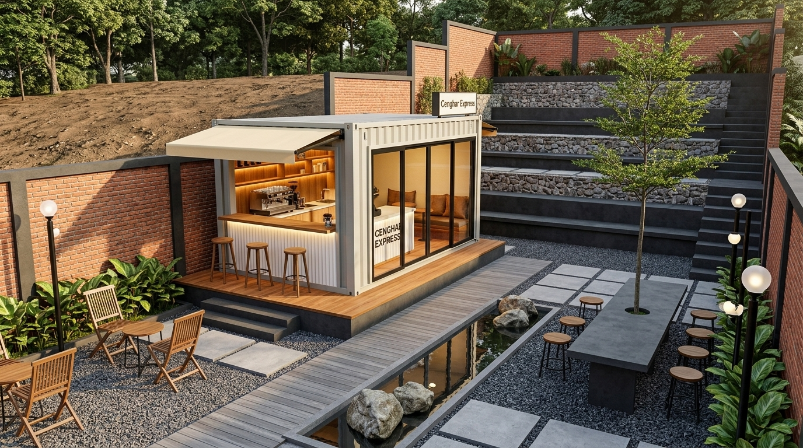
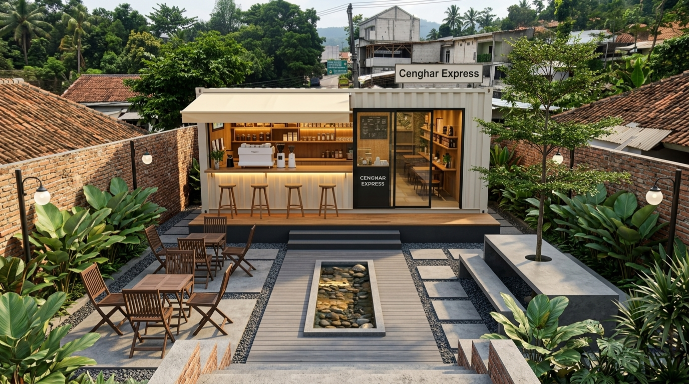
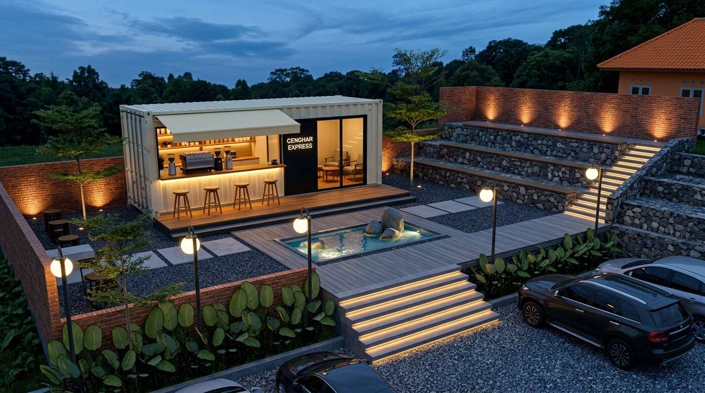
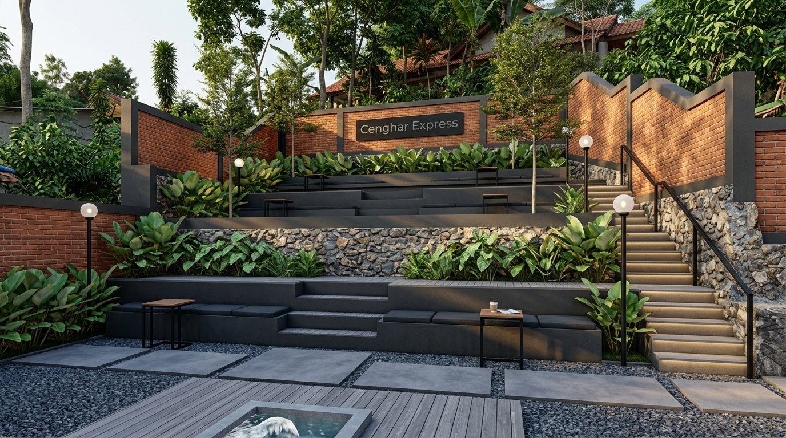

# Project #1: Cenghar Express Cililin

> **Status**: ✅ Design v1 Selesai (4 Blender Cycles 3D Renders + Interactive 360° 3D Studio)

---

## 1. Visualisasi 3D Render (Blender Cycles Style)

### A. Tampak Atas (Aerial Masterplan 3D)

### B. Tampak Booth Container & Courtyard dari Tangga Atas

### C. Suasana Senja & Malam (Twilight Lighting + Parkir Bawah)

### D. Detail Terasering Batu Kali 3 Tingkat & Tangga Sisi Kanan

---

## 2. Studio 3D Interaktif 360° (`preview-360-3d.html`)

Buka [`preview-360-3d.html`](./preview-360-3d.html) di browser untuk:
- **Putar 360° (Orbit)** dan **Geser Lahan (Pan)** ke seluruh sudut kafe
- Mengganti mode pencahayaan (**Siang**, **Sore / Golden Hour**, **Malam**)
- Klik pin label 3D (*1. Container Booth*, *2. Kolam & Deck Kayu*, *3. Meja Komunal Beton*, *4. Terasering 3 Tingkat*, *5. Parkir & Tangga Masuk*)

---

## 3. Spesifikasi Arsitektur & Material

| Zona | Detail Desain | Material Rekomendasi |
| :--- | :--- | :--- |
| **1. Container Booth (6.0 × 2.4m)** | Container 20ft putih-krem (`#EAE8E3`) di atas dek kayu jati + 2 trap tangga gelap. Kiri: bar terbuka + awning lipat krem + 4 *stool* kayu bulat + mesin espresso putih & rak *backlit*. Kanan: pintu kaca geser *frame* hitam + panel hitam **"CENGHAR EXPRESS"** & ruang duduk *indoor*. | Container modifikasi / rangka hollow + panel spandek gelombang putih doff, dek kayu WPC/jati, awning kanvas krem, kaca *tempered* + kusen aluminium hitam. |
| **2. Courtyard & Kolam Refleksi** | Jalur dek kayu abu-abu dari tangga masuk ke booth dengan **kolam refleksi persegi panjang + batu alam** di tengah, koral abu-abu gelap, dan *stepping slab* beton `100×100 cm`. | Conwood/WPC *weathered grey*, batu split/koral abu-abu gelap, beton cetak halus. |
| **3. Meja Komunal & Area Duduk** | Meja komunal beton ekspos panjang di sisi kanan dengan pohon **Ketapang Kencana** menembus tengah meja + *stool* bulat; meja & kursi lipat kayu di sisi kiri. | Beton cor acian *charcoal*, kursi lipat kayu jati, *stool* besi hitam + dudukan kayu. |
| **4. Terasering Batu Kali 3 Tingkat** | Mempertahankan 100% talud **batu kali eksisting** dan **tangga sisi kanan**. Dinding batas atas menggunakan **bata merah ekspos** dengan topi beton gelap & lampu *uplight* hangat. | Batu kali eksisting, bata merah press ekspos (*coating*), tribun duduk beton gelap, LED strip tangga 3000K. |

---

## 4. Aset Lahan & Referensi
- **Foto Kondisi Asli Lahan (10 Foto)**: [`./site-photos/`](./site-photos/)
- **Referensi Booth Container & Courtyard**: [`./references/`](./references/)
