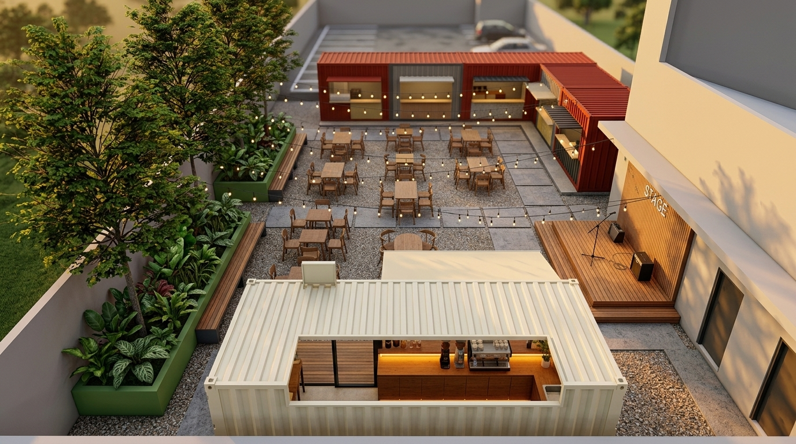
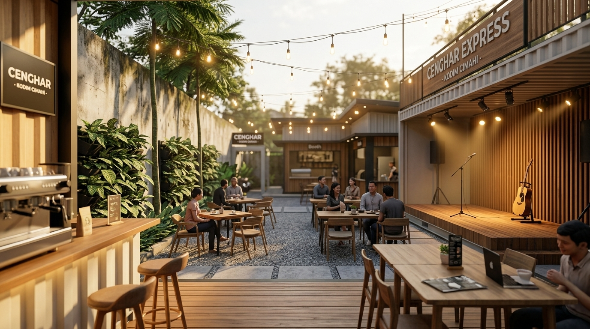
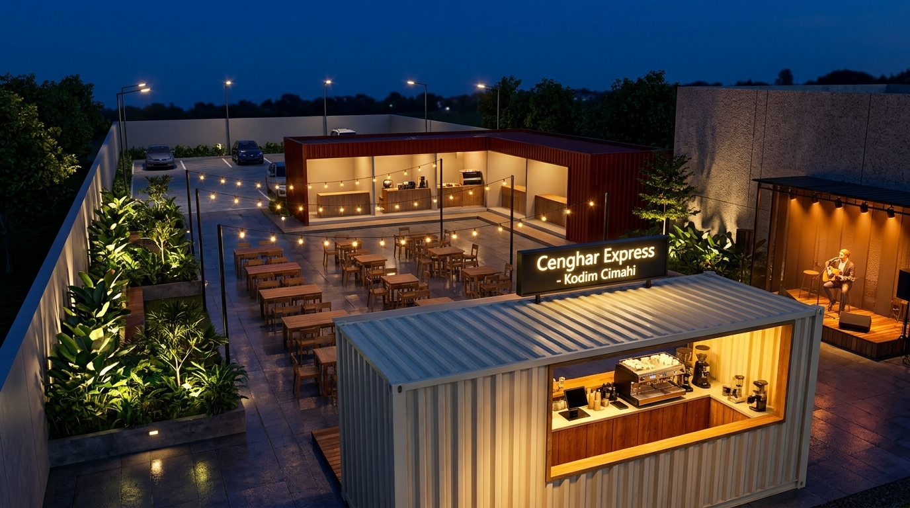

# Project #3: Cenghar Express Kodim Cimahi 🔥

> **Status**: ✅ **Design v1 Selesai** (Berdasarkan Denah Resmi `Tembok.png` + 3 Render 3D Blender Cycles + Studio 3D Interaktif WebGL 360°)

---

## 1. Analisis Denah & Zonasi Lahan (`Tembok.png`)

Berdasarkan denah layout resmi yang diberikan:

```
[ UTARA / ATAS ]
+-------------------------------------------------------+
|                      AREA PARKIR                      |
+-------------------------------------------------------+
|  [ BOOTH TENANT ] [ BOOTH TENANT ] |                  |
+------------------------------------+ [ BOOTH TENANT ] |
| [TAMAN 1]                          | (Sayap Kanan)    |
| (Hijau)                                               |
|                                                       |
|                     AREA KURSI                        |
|            (Courtyard Outdoor Seating)                |
|                                    +----------------+ |
|                                    |   MUSIC AREA   | |
| [TAMAN 2]                          | (Panggung Live)| |
| (Hijau)                            +----------------+ |
|                                    |    BANGUNAN    | |
|                                    | (Eksisting)    | |
|      +------------------------+    |                | |
|      |     CENGHAR BOOTH      |    |                | |
|      | (Hero Container Bar)   |    |                | |
|      +------------------------+    +----------------+ |
+-------------------------------------------------------+
[ SELATAN / BAWAH ]
```

| Zona pada Denah | Implementasi Desain 3D | Material & Furnitur Rekomendasi |
| :--- | :--- | :--- |
| **1. Cenghar Booth** *(Bawah / Selatan)* | **Hero Coffee Booth 20ft** warna putih-krem (`#EAE8E3`) di atas dek kayu + awning lipat kanvas krem, bar counter kayu jati dengan under-counter LED strip, mesin espresso putih, rak roastery backlit, dan signage menyala **"CENGHAR EXPRESS - KODIM CIMAHI"**. | Container modifikasi / rangka hollow + panel spandek gelombang, kayu jati/kamper, LED 3000K, kaca tempered. |
| **2. Area Kursi** *(Tengah Courtyard)* | Ruang duduk outdoor luas dengan lantai batu koral abu-abu gelap + stepping slabs beton cetak, meja kafe kayu jati 2–4 pax, bar stools, dan kanopi lampu gantung festoon melintang overhead. | Split/koral abu-abu, beton pracetak, kayu jati, lampu festoon Edison warm white. |
| **3. Music Area** *(Kanan Bawah)* | Panggung live acoustic elevated (+30 cm) dari dek kayu dengan backdrop kisi-kisi kayu vertikal, microphone stand, amplifier, dan lampu sorot panggung amber. | Rangka besi hollow + kayu decking WPC/bengkirai, lampu panggung spotlight warm. |
| **4. Bangunan Eksisting** *(Kanan Luar)* | Dinding fasad bangunan kantor Kodim eksisting yang terintegrasi rapi di belakang panggung musik. | Dinding plester acian abu-abu / krem netral. |
| **5. Tembok & 2 Area Hijau** *(Sisi Kiri)* | Dinding perimeter bata merah ekspos / industrial acian di sepanjang sisi barat, dilengkapi **2 blok planter box taman hijau** berisi tanaman tropis Calathea Lutea, bangku kayu panjang terintegrasi, dan pohon peneduh Ketapang Kencana. | Bata merah press ekspos, tanaman Calathea Lutea, Ketapang Kencana, bangku kayu. |
| **6. Booth Tenant (L-Shape)** *(Atas & Kanan Atas)* | Deretan booth tenant F&B mitra berbentuk L dengan kanopi baja hitam doff, meja serving kayu, dan papan menu berlampu. | Rangka modular container/baja hitam-merah bata, meja kayu, menu lightbox. |
| **7. Area Parkir** *(Paling Atas / Utara)* | Area parkir kendaraan roda 4 dan roda 2 dengan marka garis parkir rapi di dekat akses gerbang masuk. | Aspal / paving block / gravel padat. |

---

## 2. Galeri Render 3D Fotorealistis (Blender Cycles Style)

### A. Tampak Atas (Aerial Masterplan 3D)
Perspektif mata burung menampilkan seluruh zonasi dari Cenghar Booth (depan), Area Kursi (tengah), Music Stage & Bangunan (kanan), Tembok & Taman (kiri), hingga Booth Tenant & Parkir (belakang).


### B. Tampak dari Bar Cenghar ke Arah Panggung Musik & Courtyard
Sudut pandang pengunjung dari teras bar Cenghar menghadap panggung musik akustik, area kursi yang ramai, dan dinding taman hijau.


### C. Suasana Senja / Malam Hari (Twilight Lighting)
Pencahayaan dramatis saat senja: lampu string overhead menyala, panggung musik aktif, booth Cenghar bercahaya hangat, dan lampu taman menyorot tanaman tropis.


---

## 3. Studio 3D Interaktif WebGL 360° (`preview-360-3d.html`)

Buka [`preview-360-3d.html`](./preview-360-3d.html) di browser untuk:
- **Putar 360° (Orbit)** ke semua sudut secara bebas
- **Geser Lahan (Pan)** untuk menjelajahi area dari Cenghar Booth hingga Area Parkir
- Mengganti pencahayaan: **Siang**, **Sore (Golden Hour)**, dan **Malam (Twilight)**
- Klik pin label 3D (*Cenghar Booth*, *Area Kursi*, *Music Area*, *Booth Tenant*, *Area Parkir*)
